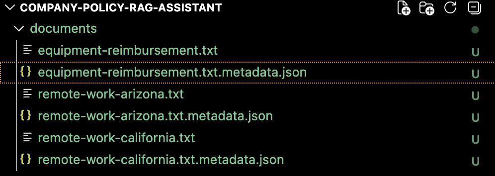
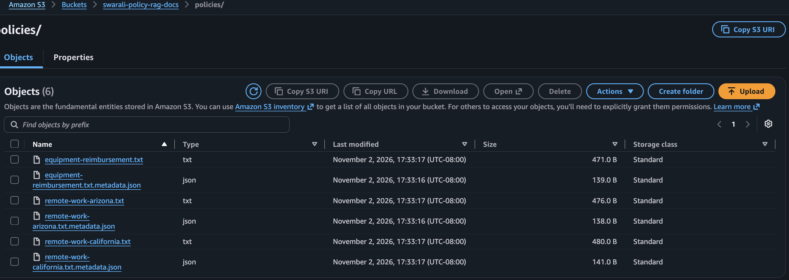
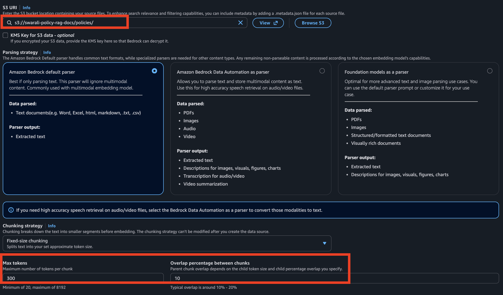
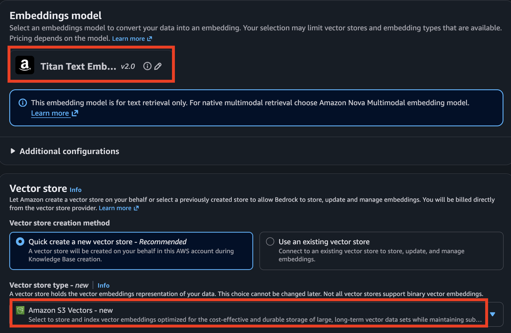
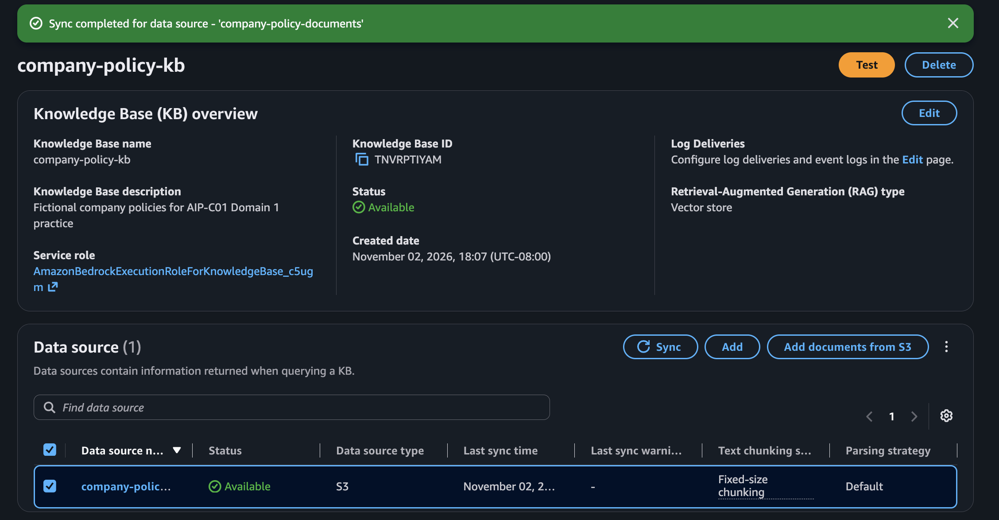
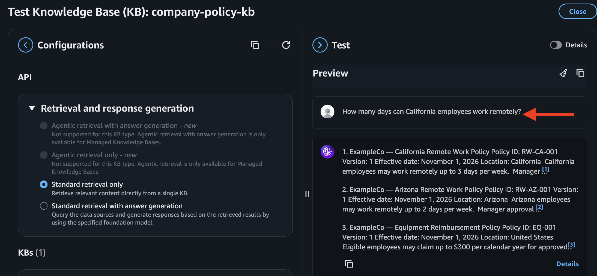
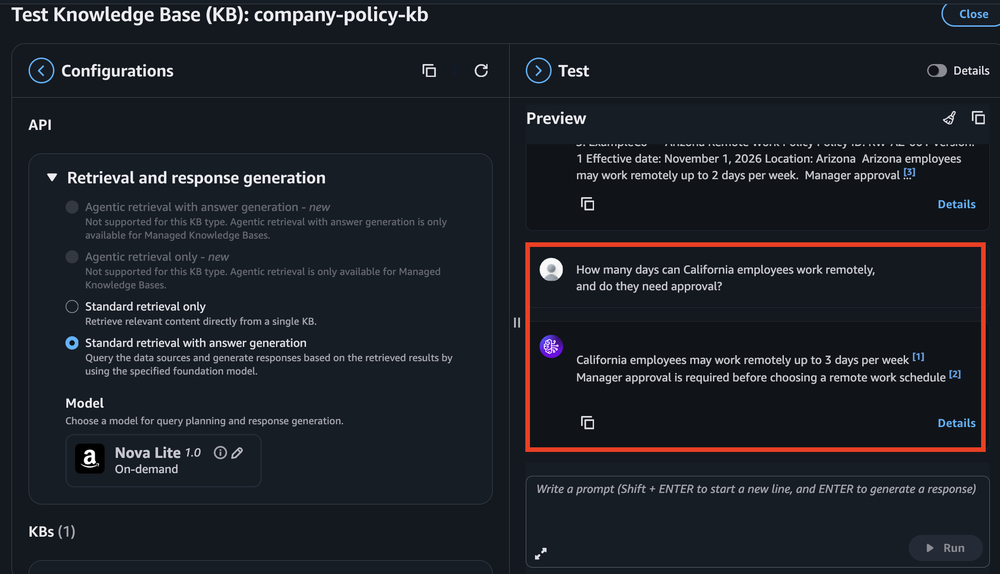
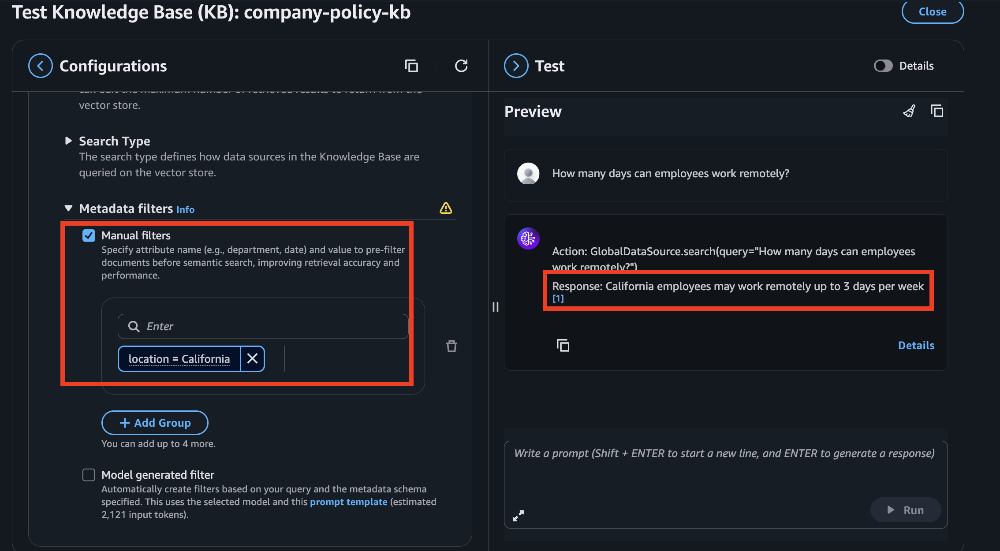
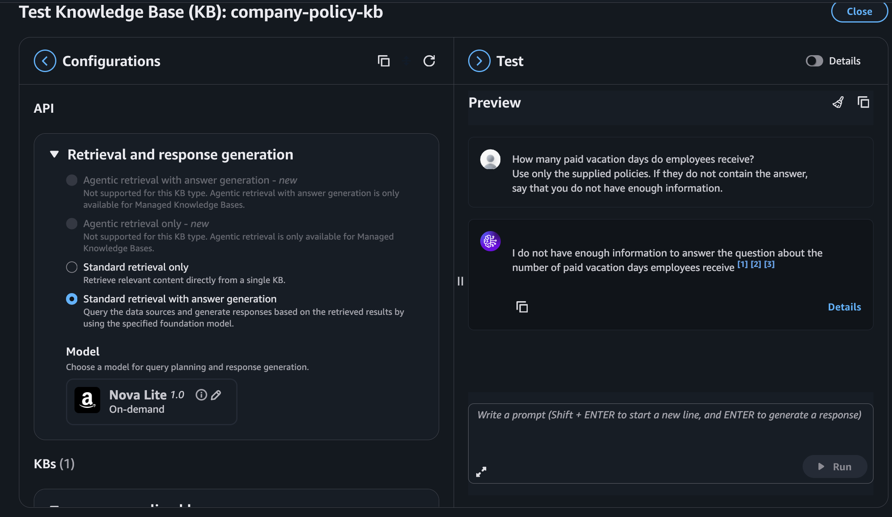
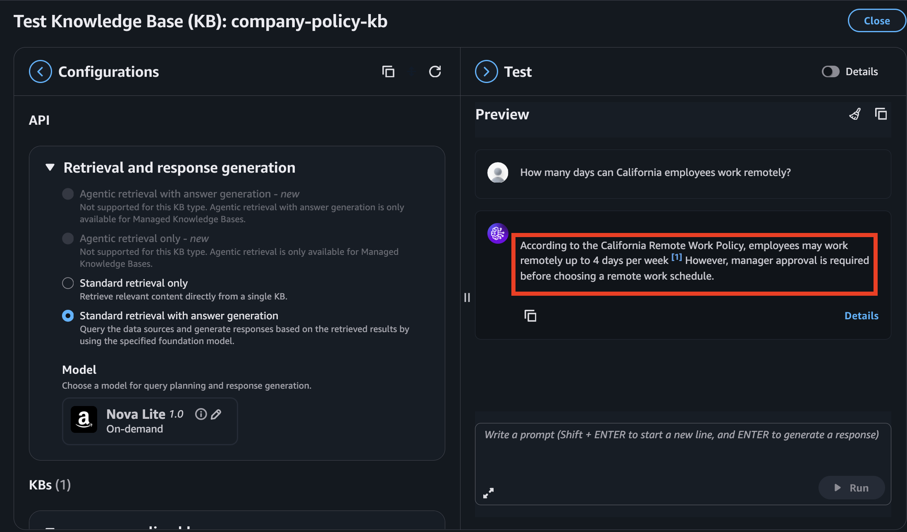

# 🏢 Company Policy RAG Assistant

A console-based hands-on project for Domain 1 of the AWS Certified Generative AI Developer – Professional (AIP-C01) exam.

The assistant uses fictional company policies to demonstrate retrieval, generated answers with citations, metadata filtering, and document updates.

## Architecture

Ingestion:
S3 documents → Parsing and chunking → Titan embeddings → S3 Vectors

Question answering:
User question → Knowledge base retrieval → Bedrock text model → Answer and citations

## AWS Services

- Amazon S3: Source documents and metadata.
- Amazon Bedrock Knowledge Bases: Ingestion and retrieval.
- Amazon Titan Text Embeddings V2: Embedding generation.
- Amazon S3 Vectors: Vector storage and semantic search.
- A supported Bedrock text model: Answer generation.

This repository documents a console implementation. It does not currently include a standalone Python application or infrastructure deployment scripts.

## Repository Contents

- documents/: Fictional policies and metadata files.
- screenshots/: Configuration and test screenshots.
- README.md: Setup, experiments, and cleanup.

## Prerequisites

- An AWS account and appropriately permitted IAM identity.
- Access to the selected embedding and generation models.
- A Region supporting the required services.
- An AWS Budget alert.

Keep the source S3 bucket and knowledge base in the same Region.

## Policy Versions

The California policy originally allowed 3 remote days per week.

The update experiment changed the allowance to 4 days and the policy version to 2.

The California files currently in this repository represent version 2.

To reproduce the initial test, change the allowance to 3 days and set the version to 1 in both the document and metadata. Restore version 2 for the update experiment.

All policies are fictional.

## Implementation

### 1. Prepare Documents and Metadata

Create three policy documents and matching .metadata.json sidecar files.

### 2. Upload to S3

Create a private general-purpose bucket and upload all six files under policies/.

### 3. Configure the Knowledge Base

Create a knowledge base with a vector store and connect the S3 source.

Use the default parser and fixed-size chunking:
- Maximum tokens: 300
- Overlap: 10%

These short documents may each fit into one chunk.

### 4. Select Embeddings and Storage

Select Titan Text Embeddings V2 and Amazon S3 Vectors.

### 5. Synchronize

Run the data-source sync and inspect ingestion results.

### 6. Test Retrieval

In retrieval-only mode, ask:

> How many days can California employees work remotely?

Inspect the relevant passage and source.

### 7. Generate an Answer

Enable response generation, choose a supported model, and ask:

> How many days can California employees work remotely, and do they need approval?

Check the answer against its citation.

### 8. Apply a Metadata Filter

Use a manual filter:

location = California

Ask:

> How many days can employees work remotely?

Repeat with location = Arizona.

### 9. Test Missing Information

Remove the location filter and ask:

> How many paid vacation days do employees receive? Use only the supplied policies. If they do not contain the answer, say that you do not have enough information.

Inspect whether the response acknowledges the missing information.

### 10. Update and Synchronize

Change California's allowance from 3 to 4 days, update both version fields to 2, replace the S3 objects, and synchronize again.

Start a fresh conversation and verify the answer and source.

## Troubleshooting

- Bucket missing: Check account, Region, and bucket type.
- Creation fails: Check IAM permissions and service-role configuration.
- Filter returns no results: Check metadata filenames, values, and synchronization.
- Old answer appears: Verify source replacement, sync status, and retrieved passages.
- Generation fails: Check the selected model's access and inference configuration.

## Limitations

- Small fictional dataset.
- Console-based testing.
- No production authentication or document-level authorization.
- No hybrid search with this S3 Vectors setup.
- Citations require verification and do not guarantee correctness.

## Cost and Cleanup

Charges can apply for storage, embeddings, vector queries, and generation.

After testing:
1. Delete the knowledge base and data source.
2. Delete remaining lab vector indexes and vector buckets.
3. Empty and delete the source bucket, including retained object versions.
4. Remove unused service roles and optional logging resources.

Check underlying resources separately after deleting the knowledge base.

## References

- [Amazon Bedrock Knowledge Bases](https://docs.aws.amazon.com/bedrock/latest/userguide/knowledge-base.html)
- [S3 Vectors integration](https://docs.aws.amazon.com/AmazonS3/latest/userguide/s3-vectors-bedrock-kb.html)
- [S3 data source configuration](https://docs.aws.amazon.com/bedrock/latest/userguide/s3-data-source-connector.html)
- [Retrieval configuration](https://docs.aws.amazon.com/bedrock/latest/userguide/kb-test-config.html)

## Author

Swarali Chine
